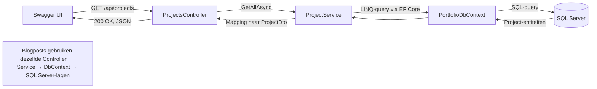

# Portfolio-backend

## Doel

Deze ASP.NET Core Web API levert projecten en blogposts voor een portfoliosite. De API gebruikt controllers, DTO-validatie en SQL Server via Entity Framework Core (EF Core). De frontend wordt niet aan deze backend gekoppeld.

## Benodigdheden

- .NET 10 SDK.
- SQL Server: de configuratie gebruikt SQL Server Express. LocalDB is een alternatief als die op je machine beschikbaar is; de connectionstring kan via configuratie worden aangepast.
- EF Core CLI (`dotnet-ef`), als lokale .NET-tool opgenomen in deze repository.
- Een browser voor Swagger UI.

## Controllers en Minimal API

Deze backend gebruikt controllers: gegroepeerde actiemethoden verwerken HTTP-verzoeken en geven HTTP-resultaten terug. Minimal API is een alternatief waarbij endpoints direct met bijvoorbeeld `app.MapGet(...)` in code worden gekoppeld, zonder controllerklassen. Dit project gebruikt bewust controllers om de HTTP-laag herkenbaar gescheiden te houden van de services.

## Mappenstructuur

`Portfolio.Api/` bevat het ene ASP.NET Core Web API-project.

```text
Portfolio.Api/
├── Controllers/       HTTP-routes en statuscodes
├── Data/              EF Core DbContext en databaseconfiguratie
├── DTOs/               HTTP-invoer- en uitvoermodellen
├── Entities/           Database-entiteiten
├── Migrations/         EF Core-databasemigraties
├── Properties/         Lokale launch-instellingen
├── Services/           Datatoegang, applicatielogica en DTO-mapping
├── Program.cs          Registraties en middleware
└── appsettings.json    Standaardconfiguratie, waaronder de connectionstring
```

Controllers kennen alleen services en DTO’s; services gebruiken `PortfolioDbContext` en mappen entiteiten naar DTO’s. De blogposts volgen dezelfde lagen als de projecten.

## SQL Server configureren

De connectionstring staat in `Portfolio.Api/appsettings.json` onder `ConnectionStrings:Portfolio`. SQL Server Express is hier als standaard ingesteld, omdat LocalDB in de gecontroleerde omgeving niet beschikbaar was:

```text
Server=.\SQLEXPRESS;Database=PortfolioDb;Trusted_Connection=True;MultipleActiveResultSets=true;TrustServerCertificate=True
```

Als LocalDB op jouw machine beschikbaar is, kun je in `appsettings.json` de waarde vervangen door:

```text
Server=(localdb)\MSSQLLocalDB;Database=PortfolioDb;Trusted_Connection=True;MultipleActiveResultSets=true;TrustServerCertificate=True
```

Voor een niet-vertrouwde of gedeelde omgeving: bewaar credentials niet in bestanden. Gebruik .NET user-secrets vanuit `backend/Portfolio.Api`:

```powershell
dotnet user-secrets init
dotnet user-secrets set "ConnectionStrings:Portfolio" "Server=SERVERNAAM;Database=PortfolioDb;User Id=GEBRUIKER;Password=WACHTWOORD;TrustServerCertificate=True"
```

Vervang de voorbeeldwaarden zelf; commit geen geheimen. Om de connectionstring via user-secrets te zetten voor LocalDB, gebruik dezelfde opdracht met de LocalDB-connectionstring.

## Herstellen, migreren en starten

Voer de volgende opdrachten uit vanuit `backend/Portfolio.Api`:

```powershell
dotnet restore
dotnet tool restore
dotnet build
dotnet ef database update
dotnet run
```

De initiële migratie staat al in `Migrations/`. `dotnet ef database update` maakt de database aan als die nog niet bestaat en past de aanwezige migraties toe. Als je later het model wijzigt, maak je vanuit dezelfde map een nieuwe migratie met bijvoorbeeld `dotnet ef migrations add AddProjectDemoUrl`. Er wordt geen `EnsureCreated` gebruikt.

De launch-instellingen starten de API op `http://localhost:5099`. Open Swagger UI op **http://localhost:5099/swagger**.

## Endpoints

Alle endpoints gebruiken DTO’s; POST en PUT ontvangen geen database-entiteiten.

| Methode | Route | Resultaat |
|---|---|---|
| GET | `/api/projects` | 200 met een lijst projecten (ook leeg als er geen zijn) |
| GET | `/api/projects/{id}` | 200 met project of 404 |
| POST | `/api/projects` | 201 met uitvoer-DTO en `Location`-header |
| PUT | `/api/projects/{id}` | 204 bij wijzigen, 404 als het project ontbreekt |
| DELETE | `/api/projects/{id}` | 204 bij verwijderen, 404 als het project ontbreekt |
| GET | `/api/blogposts` | 200 met een lijst blogposts (ook leeg als er geen zijn) |
| GET | `/api/blogposts/{id}` | 200 met blogpost of 404 |
| POST | `/api/blogposts` | 201 met uitvoer-DTO en `Location`-header |
| PUT | `/api/blogposts/{id}` | 204 bij wijzigen, 404 als de blogpost ontbreekt |
| DELETE | `/api/blogposts/{id}` | 204 bij verwijderen, 404 als de blogpost ontbreekt |

Ongeldige DTO-invoer geeft door `[ApiController]` een 400. `GitHubUrl` mag ontbreken; wanneer deze is ingevuld moet het een URL zijn.

### JSON voor Project

POST `/api/projects` en PUT `/api/projects/{id}`:

```json
{
  "titel": "Portfolio API",
  "beschrijving": "Een API voor projecten en blogposts, gebouwd met ASP.NET Core en EF Core.",
  "categorie": "Webontwikkeling",
  "gitHubUrl": "https://github.com/voorbeeld/portfolio-api",
  "datum": "2026-10-15T00:00:00"
}
```

### JSON voor Blogpost

POST `/api/blogposts` en PUT `/api/blogposts/{id}`:

```json
{
  "titel": "Mijn eerste API",
  "inhoud": "Ik heb geleerd hoe controllers, services en EF Core samenwerken.",
  "publicatiedatum": "2026-10-15T09:00:00"
}
```

## Handmatige testchecklist in Swagger

Voer onderstaande stappen eerst voor **Projects** en daarna voor **Blogposts** uit. Gebruik de bijbehorende JSON hierboven. Noteer het ID dat de POST-response teruggeeft.

1. POST een item. Controleer status 201, de response-DTO met gegenereerd `id` en de `Location`-header.
2. GET alle items; controleer dat het aangemaakte item in de lijst staat.
3. GET op het ontvangen ID; controleer de details.
4. PUT op dat ID met aangepaste gegevens; controleer status 204.
5. GET op hetzelfde ID en controleer de gewijzigde gegevens.
6. Stop de applicatie en start deze opnieuw met `dotnet run`.
7. GET opnieuw op hetzelfde ID; controleer dat de wijziging bewaard is.
8. DELETE op dat ID; controleer status 204.
9. GET opnieuw op hetzelfde ID; controleer status 404.
10. Voer PUT uit met een ongebruikt ID, bijvoorbeeld `2147483647`; controleer 404.
11. Voer DELETE uit met hetzelfde onbekende ID; controleer 404.
12. Optioneel: stuur bij Project een ongeldige `gitHubUrl` en controleer status 400.

## Screenshots voor de opdracht

Maak zelf screenshots van:

1. Swagger UI met de tien zichtbare endpoints.
2. Een geslaagde POST-response voor een project, inclusief ID en 201-status.
3. Een geslaagde POST-response voor een blogpost, inclusief ID en 201-status.
4. Een PUT met status 204 en de daaropvolgende GET die de wijziging toont.
5. De GET na herstart die de blijvende opslag aantoont.
6. De DELETE en daaropvolgende GET met status 404.
7. Een PUT en DELETE met een onbekend ID die beide 404 geven.

Neem alleen screenshots van daadwerkelijk door jou uitgevoerde tests op.

## Request-flow



## Voorgestelde commits

Maak deze commits zelf, verspreid over minimaal drie weken; er zijn geen commits voor je gemaakt:

**Week 1**

1. `chore: scaffold .NET 10 Web API project`
2. `feat: add portfolio entities and DTO validation`

**Week 2**

3. `feat: add SQL Server DbContext and initial migration`
4. `feat: add project service and CRUD endpoints`

**Week 3**

5. `feat: add blogpost service and CRUD endpoints`
6. `docs: document API setup and manual Swagger tests`
